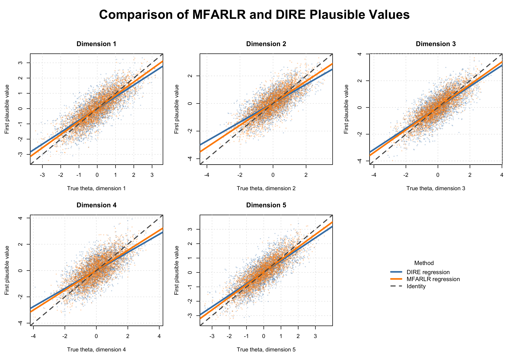

# FARL: Use Factor-Augmented Regularized Latent Regression for Large-Scale Assessment

## Introduction

The `FARL` package implements factor-augmented regularized latent
regression (FARLR) for large-scale assessments. FARLR addresses
high-dimensional, strongly dependent background variables by separating
their common variation from covariate-specific information.
Common-factor scores enter the latent regression, while sparse
regularization identifies a smaller set of additional background
variables associated with achievement.

For multidimensional assessments, MFARLR extends the same strategy to
several correlated latent traits. It estimates the regression
coefficients and the full residual covariance jointly. This preserves
dependence among dimensions when plausible values are generated for
population and subgroup analyses.

The package supports:

- unidimensional FARLR estimation through
  [`Farlr_mml()`](https://map-lab-uw.github.io/FARL/reference/Farlr_mml.md);
- unidimensional PCA-based DIRE estimation through
  [`Dire_mml()`](https://map-lab-uw.github.io/FARL/reference/Dire_mml.md);
- multidimensional FARLR-GVEM estimation through
  [`MFARLR_mml()`](https://map-lab-uw.github.io/FARL/reference/MFARLR_mml.md);
- multidimensional DIRE estimation through
  [`MDIRE_mml()`](https://map-lab-uw.github.io/FARL/reference/MDIRE_mml.md);
  and
- plausible-value generation for all fitted models.

This vignette first presents the unidimensional workflow and then the
multidimensional workflow. The emphasis is on preparing data, fitting
models, interpreting returned objects, generating plausible values, and
conducting secondary analyses rather than on mathematical derivations.

## Installation and loading

The development version can be installed with:

``` r
if (!requireNamespace("devtools", quietly = TRUE)) {
  install.packages("devtools")
}

devtools::install_github(
  "MAP-LAB-UW/FARL",
  build_vignettes = TRUE
)

torch::install_torch()
```

``` r
library(FARL)
```

## Common data interface

The main fitting functions use a common set of data objects.

| Function | Covariates | Responses | Item parameters |
|:---|:--:|:--:|:--:|
| [`Farlr_mml()`](https://map-lab-uw.github.io/FARL/reference/Farlr_mml.md) | `X` | `Y` | `parTab` |
| [`MFARLR_mml()`](https://map-lab-uw.github.io/FARL/reference/MFARLR_mml.md) | `X` | `Y` | `parTab` |
| [`MDIRE_mml()`](https://map-lab-uw.github.io/FARL/reference/MDIRE_mml.md) | `X` | `Y` | `parTab` |

Rows of `X` and `Y` must refer to the same respondents, and rows of
`parTab` must follow the item-column order in `Y`. The unidimensional
section first shows how to construct `parTab`. The additional MFARLR
control object is introduced later, when the multidimensional model is
fitted.

## Unidimensional FARLR

The two unidimensional FARLR estimation strategies differ in how they
reduce the bias introduced by penalized variable selection.

| Method | Main idea | Advantage 1 | Advantage 2 |
|:---|:---|:---|:---|
| `FARLR_EMM` | Uses the importance-sampling-based EMM algorithm (ISEMM). Each iteration includes an importance-sampling E-step, a penalized M-step that performs variable selection using LASSO, and a second unpenalized M-step that refits the selected active set. | Produces stable subgroup mean and variance estimates, particularly for moderate and large subgroups. | Remains comparatively robust in high-dimensional settings. |
| `FARLR_Debias` | Uses an importance-sampling-based EM algorithm. After separating the factor and idiosyncratic components, the penalized M-step obtains LASSO estimates, followed by a debiasing correction to the idiosyncratic coefficients. | More accurately identifies covariates with truly nonzero effects. | Performs especially well for small subgroups in high-dimensional settings. |

[`Farlr_mml()`](https://map-lab-uw.github.io/FARL/reference/Farlr_mml.md)
provides a common interface for two estimators.

#### Parameters passed directly to `FARLR_mml()`

Both methods evaluate candidate `lambda` values, use the same
convergence criterion, and select `lambda` by BIC. Use `FARLR_EMM` for
LASSO selection followed by active-set refitting, and `FARLR_Debias`
when explicit correction of regularization shrinkage is desired.

The examples in this section use
[`Farlr_mml()`](https://map-lab-uw.github.io/FARL/reference/Farlr_mml.md)
to fit the model and
[`Farlr_drawPVs()`](https://map-lab-uw.github.io/FARL/reference/Farlr_drawPVs.md)
to generate plausible values.

### Prepare the data

[`Farlr_mml()`](https://map-lab-uw.github.io/FARL/reference/Farlr_mml.md)
uses three required data objects.

| Object | Required organization | Purpose |
|:---|:---|:---|
| `X` | Respondents by covariates | Background variables used in the population model. All columns must be numeric, finite, and have nonzero variance. |
| `Y` | Respondents by items | Item responses. Rows must correspond exactly to the rows of `X`. Missing responses may be coded `NA`. |
| `parTab` | One row per item | Fixed item parameters. Its row order must match the column order of `Y`. |

The package supports binary 1PL, 2PL, and 3PL items, as well as
three-category GPCM items. Binary responses must be coded 0/1, and GPCM
responses must be coded 0/1/2. The package determines item type from the
supplied item parameters.

#### Construct a unidimensional `parTab`

`parTab` is an item-level data frame. It must have exactly one row for
every column of `Y`, in the same order. The `sim_a1` table can be
constructed as follows.

``` r
item_difficulty <- c(
  0.68394525, 0.92141771, 1.57513353,
  1.63897827, 0.06180150, 0.02206284
)

item_slope <- c(
  0.7808753, 1.0839744, 0.6168007,
  1.1808368, 0.8086742, 1.0941187
)

parTab_a1 <- data.frame(
  item = seq_along(item_slope),
  b = item_difficulty,
  a = item_slope,
  c = 0,
  ItemID = paste0("item", seq_along(item_slope)),
  test = "comp",
  subtest = "main",
  slope = item_slope,
  difficulty = item_difficulty,
  guessing = 0,
  D = 1L
)

parTab_a1
# item b a c ItemID test subtest slope difficulty
# 1 0.68394525  0.7808753   0   item1   comp    main    0.7808753   0.68394525  
# 2 0.92141771  1.0839744   0   item2   comp    main    1.0839744   0.92141771  
# 3 1.57513353  0.6168007   0   item3   comp    main    0.6168007   1.57513353  
# 4 1.63897827  1.1808368   0   item4   comp    main    1.1808368   1.63897827  
# 5 0.06180150  0.8086742   0   item5   comp    main    0.8086742   0.06180150  
# 6 0.02206284  1.0941187   0   item6   comp    main    1.0941187   0.02206284
```

The columns have the following roles.

| Column | Meaning |
|:---|:---|
| `item` | Item sequence number. Row order must match the columns of `Y`. |
| `a` | Item discrimination or slope used by [`Farlr_mml()`](https://map-lab-uw.github.io/FARL/reference/Farlr_mml.md). |
| `b` | Item difficulty. FARL converts it internally to the intercept needed by the response model. |
| `c` | Guessing parameter. Set it to zero for 1PL/2PL items and to a value between zero and one for 3PL items. |
| `ItemID` | Readable item identifier. It should be unique. |
| `test` | Test label retained as item metadata. |
| `subtest` | Subtest label retained as item metadata. For this unidimensional example all items use `"main"`. |
| `slope` | Descriptive duplicate of `a`, retained for compatibility with other interfaces. |
| `difficulty` | Descriptive duplicate of `b`. |
| `guessing` | Descriptive duplicate of `c`. |
| `D` | Unidimensional metadata flag. It is `1` for every item in this example. |

For
[`Farlr_mml()`](https://map-lab-uw.github.io/FARL/reference/Farlr_mml.md),
the essential columns in this 2PL example are `a`, `b`, and `c`. The
remaining columns provide identifiers and compatibility metadata. If
intercepts are already available, supply `d` instead of `b`.

The required item parameters change with item type:

| Item type | Required information in `parTab` | Response coding |
|:---|:---|:---|
| 1PL/2PL | `a`, either `b` or `d`, and `c = 0` | 0/1, with optional `NA` |
| 3PL | `a`, either `b` or `d`, and a nonzero `c` between 0 and 1 | 0/1, with optional `NA` |
| Three-category GPCM | `a`, `b1`, and `b2`; `c` may be zero or omitted | 0/1/2, with optional `NA` |

#### Example data

`sim_a1` contains 300 respondents, 100 background variables, and six
binary 2PL items. The true latent trait is retained only for simulation
diagnostics.

``` r
data(sim_a1)

dim(sim_a1$X)
# [1] 300 100

dim(sim_a1$Y)
# [1] 300   6

head(sim_a1$Y)
#      i001 i002 i003 i004 i005 i006
# [1,]    1    1    0    0    0    1
# [2,]    0    1    0    1    0    0
# [3,]    1    0    1    0    0    1
# [4,]    0    0    0    0    1    1
# [5,]    0    0    0    0    0    1
# [6,]    0    0    0    0    1    1
     
head(sim_a1$X[, 1:6])
#      [,1] [,2] [,3] [,4] [,5]       [,6]
# [1,]    0    1    0    1    0  0.2837093
# [2,]    1    1    1    1    1  0.9718186
# [3,]    1    1    1    1    1  1.2179341
# [4,]    1    1    1    1    1  1.7088599
# [5,]    0    0    0    0    0 -3.5649492
# [6,]    1    1    1    1    1  1.2663585

sim_a1$parTab
# item b a c ItemID test subtest slope difficulty
# 1 0.68394525  0.7808753   0   item1   comp    main    0.7808753   0.68394525  
# 2 0.92141771  1.0839744   0   item2   comp    main    1.0839744   0.92141771  
# 3 1.57513353  0.6168007   0   item3   comp    main    0.6168007   1.57513353  
# 4 1.63897827  1.1808368   0   item4   comp    main    1.1808368   1.63897827  
# 5 0.06180150  0.8086742   0   item5   comp    main    0.8086742   0.06180150  
# 6 0.02206284  1.0941187   0   item6   comp    main    1.0941187   0.02206284
```

Before fitting the model, verify row alignment, item alignment, response
codes, and missingness.

``` r
stopifnot(nrow(sim_a1$X) == nrow(sim_a1$Y))
stopifnot(nrow(sim_a1$parTab) == ncol(sim_a1$Y))

mean(is.na(sim_a1$Y))
# [1] 0

table(sim_a1$Y, useNA = "ifany")
#    0    1 
# 1155  645 

apply(sim_a1$X, 2, sd) |>
  summary()
#   Min. 1st Qu.  Median    Mean 3rd Qu.    Max. 
# 0.4992  0.5006  0.5412  0.7574  1.0498  1.5723 
```

#### Choose primary covariates

The `main` argument identifies covariates that must remain in the
population model. These variables are not removed by penalized
selection. Supply their column indices in `X`.

``` r
main <- c(1, 2, 15, 29, 45)

main_names <- if (is.null(colnames(sim_a1$X))) {
  paste0("X", main)
} else {
  colnames(sim_a1$X)[main]
}

main_names
# [1] "X1"  "X2"  "X15" "X29" "X45"
```

Use `main = integer(0)` when every original covariate may be selected or
excluded by regularization.

### Fit FARL

#### Main fitting arguments

| Argument | Applied meaning |
|:---|:---|
| `X`, `Y`, `parTab` | Data objects described above. |
| `method` | Selects `"FARLR_EMM"` or `"FARLR_Debias"`. |
| `main` | Column indices of primary covariates that remain in the model. |
| `lambda` | Candidate regularization values. A wider grid is useful when the selected value falls at an endpoint. |
| `n_sam` | Monte Carlo sample size used during fitting. Larger values reduce simulation noise but increase runtime. |
| `n_sam_final` | Monte Carlo sample size used in the final evaluation or debiased update. |
| `K_hat` | Optional number of common factors. When omitted, FARL estimates it using parallel analysis. |
| `delta.criteria` | Convergence tolerance for iterative updates. |
| `iter.max` | Maximum number of iterations for each candidate regularization value. |
| `window.size` | Number of recent updates used for stabilization. |
| `proposal_inflation` | Controls the spread of the latent-trait proposal distribution used during Monte Carlo integration. |
| `seed` | Makes factor selection and Monte Carlo calculations reproducible. |
| `progress`, `verbose` | Control progress bars and printed fitting information. |

The defaults provide a convenient starting point. For a final analysis,
inspect convergence and check whether results remain stable with larger
Monte Carlo sample sizes and a broader `lambda` grid.

#### Fit FARLR-Debias

This fit uses ISEM together with the paper’s debiasing step.

``` r
mmlcomp_debias <- with(
  sim_a1,
  Farlr_mml(
    X = X,
    Y = Y,
    parTab = parTab,
    method = "FARLR_Debias",
    main = main,
    lambda = seq(0.05, 0.50, length.out = 10),
    n_sam = 25L,
    n_sam_final = 60L,
    seed = 2026,
    progress = TRUE
  )
)
#  |++++++++++++++++++++++++++++++++++++++++++++++++++| 100% elapsed=00s  
#  |==============================================================================| 100%
```

#### Fit FARLR-EMM

This fit uses the paper’s ISEMM procedure. The input interface is the
same; only `method` changes.

``` r
mmlcomp_emm <- with(
  sim_a1,
  Farlr_mml(
    X = X,
    Y = Y,
    parTab = parTab,
    method = "FARLR_EMM",
    main = main,
    lambda = seq(0.05, 0.50, length.out = 10),
    n_sam = 25L,
    n_sam_final = 60L,
    seed = 2026,
    progress = TRUE
  )
)
#  |++++++++++++++++++++++++++++++++++++++++++++++++++| 100% elapsed=00s  
#  |==============================================================================| 100%
```

### Examine a fitted FARL model

The fitted object contains the coefficient estimates together with the
factor-adjusted design, item information, scaling values, and fitting
diagnostics needed for later plausible-value generation.

| Component | Interpretation |
|:---|:---|
| `coefficients` | Named regression coefficients. Names beginning with `FS` refer to common-factor scores; names beginning with `X` refer to original covariates. |
| `sigma` | Residual standard deviation of the latent trait after conditioning on the fitted predictors. |
| `lambda` | Selected regularization value. |
| `LogLik` | Objective or likelihood summary returned for the selected model. |
| `Convergence` | Method-specific convergence indicator. |
| `factor_scores` | Estimated common-factor scores for each respondent. |
| `K_hat` | Number of common factors used in the fitted model. |
| `hatU` | Factor-adjusted covariates used by `FARLR_Debias`. |
| `Fan` | Final factor-plus-adjusted-covariate design used by `FARLR_Debias`. |
| `X`, `X_center`, `X_scale` | Standardized covariates and the values used to standardize them. |
| `item_params`, `item_type` | Item parameters and detected response-model type. |
| `stuDat`, `stuItems` | Subject-level design information and long-format item responses retained for compatibility and PV generation. |

#### Check method and convergence

``` r
mmlcomp_debias$method
# [1] "FARLR_Debias"

mmlcomp_debias$K_hat
# [1] 2

mmlcomp_debias$lambda
# [1] 0.05

mmlcomp_debias$LogLik
# [1] -281.1571

mmlcomp_debias$Convergence
# [1] "Converged"
```

If the selected `lambda` is the smallest or largest candidate, extend
the grid and refit. If the model does not converge, increase `iter.max`,
review the input variables, and assess stability across seeds and Monte
Carlo settings.

#### Summarize coefficients

Printing every coefficient is difficult when `X` is wide. A compact
table of the largest coefficients is usually more informative.

``` r
coefficient_table <- data.frame(
  predictor = names(mmlcomp_debias$coefficients),
  coefficient = as.numeric(mmlcomp_debias$coefficients),
  row.names = NULL
)

coefficient_table$source <- ifelse(
  grepl("^FS", coefficient_table$predictor),
  "Common factor",
  "Original covariate"
)

coefficient_table <- coefficient_table[
  order(abs(coefficient_table$coefficient), decreasing = TRUE),
]

head(coefficient_table, 15L)
# predictor coefficient source
# 73    X71 0.6400820   Original covariate  
# 2 FS2 0.5169816   Common factor   
# 78    X76 0.4347478   Original covariate  
# 91    X89 -0.4185053  Original covariate  
# 90    X88 0.3937220   Original covariate  
# 26    X24 -0.3324180  Original covariate  
# 37    X35 0.2714997   Original covariate  
# 81    X79 -0.2629103  Original covariate  
# 61    X59 -0.2584331  Original covariate  
# 30    X28 0.2282416   Original covariate
```

A positive coefficient indicates that higher values of the predictor are
associated with a higher population mean for the latent trait, holding
the other included predictors constant. Coefficients describe
associations and should not be interpreted causally.

The common-factor scores summarize shared variation across `X`.
Covariate coefficients represent information that remains useful after
the factor adjustment. Primary variables supplied through `main` should
be interpreted alongside the selected covariates rather than as a
separate model.

#### Interpret residual variation

``` r
round(mmlcomp_debias$sigma,3)
# [1] 0.62

round(mmlcomp_emm$sigma,3)
# [1] 0.725
```

`sigma` is a residual standard deviation, not a variance. A smaller
value indicates that the fitted population model leaves less
latent-trait variation unexplained. Comparisons are most useful when the
same data, item parameters, and latent scale are used.

#### Inspect the factor-adjusted design

``` r
dim(mmlcomp_debias$factor_scores)
# [1] 300   2

head(round(mmlcomp_debias$factor_scores,3))
#         FS1    FS2
# [1,] -0.693 -0.710
# [2,]  0.486  0.773
# [3,] -1.008  0.773
# [4,]  0.693  1.312
# [5,] -1.466 -2.770
# [6,]  0.638  1.147
            
dim(mmlcomp_debias$hatU)
# [1] 300 100

dim(mmlcomp_debias$Fan)
# [1] 300 102
```

`FARLR_Debias` uses `Fan`, which combines common-factor scores and
factor-adjusted covariates. These stored objects are useful for
reconstructing the fitted design during plausible-value generation and
for diagnosing unexpected coefficients in the fitted sample.

### Generate plausible values

[`Farlr_drawPVs()`](https://map-lab-uw.github.io/FARL/reference/Farlr_drawPVs.md)
combines the fitted population model with each respondent’s observed
item responses. It returns plausible values together with posterior
summaries that are useful for checking the generated draws. Plausible
values are intended for population and subgroup analyses, not for
reporting an individual’s single score.

#### Plausible-value arguments

| Argument | Applied meaning |
|:---|:---|
| `mmlcomp` | Object returned by [`Farlr_mml()`](https://map-lab-uw.github.io/FARL/reference/Farlr_mml.md). |
| `npv` | Number of plausible values generated for each respondent. |
| `n_quad` | Number of points used to approximate each respondent’s posterior distribution. |
| `theta_range` | Lower and upper limits of the initial latent-score grid. |
| `adaptive_range` | When `TRUE`, allows the grid to expand for respondents whose fitted prior lies near or beyond the initial limits. |
| `range_sd` | Controls how far the adaptive grid extends around the fitted prior mean. |
| `design_matrix` | Optional replacement design matrix. Normally omitted so that FARL reconstructs the fitted design automatically. |
| `theta` | Optional true trait values used only for simulation diagnostics. Omit this argument for real data. |
| `seed` | Makes plausible-value generation reproducible. |
| `return_details` | When `TRUE`, returns the PV matrix and posterior summaries in a list. |

#### Draw plausible values

``` r
farl_pvs <- Farlr_drawPVs(
  mmlcomp = mmlcomp_debias,
  npv = 10L,
  n_quad = 30L,
  theta_range = c(-4, 4),
  adaptive_range = TRUE,
  range_sd = 1,
  seed = 2026,
  progress = TRUE,
  return_details = TRUE
)
#  |==============================================================================| 100%
```

For simulation studies, `theta = sim_a1$theta` may be added to report
the difference between the average posterior estimate and the average
true trait. It should not be supplied in an empirical analysis.

#### Examine plausible-value output

| Component | Interpretation |
|:---|:---|
| `data` | Numeric matrix containing only the plausible values. |
| `datPVs` | Data frame containing respondent IDs and columns `_farl1`, `_farl2`, and so on. |
| `EAP_estimates` | Respondent-level posterior means. |
| `EAP_variance` | Respondent-level posterior variances. |
| `posterior_mode` | Most likely grid value for each respondent. |
| `prior_mean` | Latent-regression mean predicted by the fitted population model. |
| `sigma` | Residual standard deviation copied from the fitted model. |
| `mean_difference` | Simulation-only mean recovery diagnostic; `NA` when `theta` is omitted. |

``` r
head(farl_pvs$datPVs)
# id _farl1 _farl2 _farl3 _farl4 _farl5
# 1 0.4415057   -0.39299729 0.24264142  0.1258383   -0.17760220 
# 2 0.2174657   0.05058925  0.31419779  0.3119294   -0.89014627 
# 3 -0.2252654  -0.13906095 -0.78423791 0.7180437   -0.02715238 
# 4 -0.0520972  0.30991841  0.09067852  0.3965440   0.31826952  
# 5 -2.1700373  -1.07371436 -2.19664464 -1.3406977  -1.98672013 
# 6 -0.5599810  -0.05541882 -0.43469715 0.2878315   -0.28505926 
```

Large posterior variances identify respondents whose response patterns
provide less information about the latent trait. Differences between
`prior_mean` and `EAP_estimates` show how the observed item responses
update predictions from the background variables.

### Mixed 3PL and GPCM responses

The same FARL workflow applies when the assessment contains both binary
3PL items and three-category GPCM items. `sim_a2` demonstrates this
case.

``` r
data(sim_a2)

dim(sim_a2$X)
# [1] 300 100

dim(sim_a2$Y)
# [1] 300   6

table(sim_a2$itemtype)
# 3PL gpcm 
#  3    3 

sim_a2$parTab[, c(
  "ItemID", "itemtype", "a", "b", "c", "b1", "b2"
)]
# ItemID itemtype a b c b1 b2
# item1 3PL 0.7808753   0.6839453   0.2364617   NA  NA
# item2 gpcm    1.0839744   NA  0.0000000   0.4103240   1.2342899
# item3 3PL 0.6168007   0.9214177   0.1773176   NA  NA
# item4 gpcm    1.1808368   NA  0.0000000   -1.1282366  -0.0933918
# item5 3PL 0.8086742   1.5751335   0.1758274   NA  NA
# item6 gpcm    1.0941187   NA  0.0000000   -0.1558467  0.7680919
```

Fit the model and generate PVs using the same public functions.

``` r
mmlcomp_mixed <- with(
  sim_a2,
  Farlr_mml(
    X = X,
    Y = Y,
    parTab = parTab,
    method = "FARLR_Debias",
    main = main,
    seed = 2026
  )
)
#  |++++++++++++++++++++++++++++++++++++++++++++++++++| 100% elapsed=00s  
#  |==============================================================================| 100%

table(mmlcomp_mixed$item_type)
# 3pl gpcm 
#  3    3

pvs_mixed <- Farlr_drawPVs(
  mmlcomp = mmlcomp_mixed,
  npv = 10L,
  adaptive_range = TRUE,
  seed = 2026
)
# |==============================================================================| 100%

head(pvs_mixed$datPVs)
# id _farl1 _farl2 _farl3 _farl4 _farl5
# 1 -0.44981607 -1.1822068  -0.62434674 -0.7268575  -0.99316810 
# 2 0.94040775  0.7950428   1.02467040  1.0226945   -0.02442559 
# 3 -0.32120661 -0.2483761  -0.79345840 0.4757547   -0.15382940 
# 4 -0.19328627 0.1077317   -0.07456747 0.1797614   0.11467569  
# 5 -1.62911580 -0.7149930  -1.65130125 -0.9376058  -1.47626451 
# 6 0.09680734  0.5244688   0.20299657  0.8154040   0.32982803  
```

For mixed-format assessments, check that every `parTab` row contains the
parameters required by its item type. Missing responses remain coded as
`NA` and are ignored for the corresponding item during posterior
calculation.

### Unidimensional practical checks

Before reporting a FARL analysis, verify the following:

- rows of `X` and `Y` refer to the same respondents;
- rows of `parTab` match the item-column order in `Y`;
- covariates are numeric and have nonzero variance;
- response codes agree with their item types;
- primary covariates in `main` are the intended columns of `X`;
- the selected `lambda` is not constrained by an inadequate grid;
- fitting results are stable across Monte Carlo seeds and larger sample
  sizes;
- `sigma` is positive and convergence diagnostics are acceptable; and
- all plausible values, rather than their respondent-level average, are
  used in secondary analyses.

## Multidimensional FARLR and DIRE comparison

Multidimensional large-scale assessments must model both
high-dimensional, correlated background variables and dependence among
latent traits. A PCA-only population model can discard low-variance
covariate information that remains predictive of achievement, while
fitting latent-trait covariances separately can yield an incoherent
covariance estimate. MFARLR instead combines common factors with
sparsely selected covariates and estimates the dimensions jointly.

In practice, MFARLR uses the background variables to predict each latent
dimension while retaining correlations among the dimensions. It combines
common-factor scores with selected covariates, then estimates the
regression coefficients and residual covariance jointly. The current
multidimensional implementation supports binary 2PL items, so guessing
parameters must be zero.

This example reports not only the final plausible values, but also the
selection matrix, regression coefficients, residual covariance,
variational posterior moments, and convergence diagnostics produced
during estimation.

### Input data

The multidimensional functions retain the same compact data interface.
Both models receive `X`, `Y`, and `parTab`; item slopes, intercepts, and
dimension assignments are obtained from `parTab` internally. In this
simulation, `theta` is also available for evaluating recovery, but it is
never supplied to the fitting function.

| Object | Required shape | Role |
|:---|:---|:---|
| `X` | Respondents by covariates | Background variables used to construct common-factor scores and factor-adjusted residual covariates. Values must be finite. |
| `Y` | Respondents by items | Binary item responses coded 0/1. Missing responses may be coded `NA`; they are omitted during estimation. |
| `parTab` | One row per item | Fixed item parameters and dimension assignments. It supplies the slopes, intercepts or difficulties, and the latent dimension measured by each item. |
| `main` | Integer column indices | Primary covariates that are not penalized during dimension-specific FARLR screening. |
| `theta` | Respondents by dimensions | True latent traits available only in the simulation; used below to calculate recovery statistics. |

[`MFARLR_mml()`](https://map-lab-uw.github.io/FARL/reference/MFARLR_mml.md)
still requires `parTab`; it cannot infer item parameters from `Y`. The
construction follows the unidimensional example above, with one
additional item-dimension column such as `dimension` or `subtest`. The
current MFARLR implementation supports binary 2PL items, so `c` or
`guessing` must be zero. The example below uses the prepared
`sim_m1$parTab` table.

``` r
data(sim_m1)

dim(sim_m1$X)
# [1] 3000   60

dim(sim_m1$Y)
# [1] 3000   30

dim(sim_m1$theta)
# [1] 3000    5

head(sim_m1$parTab)
#item dimension b a d c ItemID test
# 1 1   1   0.9090085   1.0852796   -0.9865284  0   item1   mcomp   dimension1  
# 2 2   1   -1.4605271  0.9679681   1.4137436   0   item2   mcomp   dimension1  
# 3 3   1   0.7797827   0.8828721   -0.6884484  0   item3   mcomp   dimension1  
# 4 4   1   -0.2210281  1.1166641   0.2468141   0   item4   mcomp   dimension1  
# 5 5   1   -0.7199442  1.0148336   0.7306235   0   item5   mcomp   dimension1  
# 6 6   1   0.8171910   1.1513335   -0.9408594  0   item6   mcomp   dimension1  
```

The item-parameter parser accepts either a complete loading matrix for
cross-loading items or a simple-structure representation with one slope
and one dimension label per item. If `difficulty` or `b` is supplied
instead of an intercept, FARL converts it internally. The stored `d`
values are therefore on the logit-intercept scale, not the conventional
item-difficulty scale.

### Fit MFARLR-GVEM

MFARLR uses three steps. First, factor analysis summarizes the common
variation in the standardized covariates. Second, `FARLR_Debias` screens
covariates within each latent dimension and records a dimension-specific
selection pattern. Third, these selected positions are held fixed while
GVEM jointly updates the coefficient matrix, person-specific variational
moments, and the full latent residual covariance. The Gaussian
variational posterior makes these updates computationally feasible
without multidimensional quadrature.

#### Parameters passed directly to `MFARLR_mml()`

| Parameter | Meaning |
|:---|:---|
| `X`, `Y`, `parTab` | Data objects described above. The rows of `X` and `Y` must refer to the same respondents, and `parTab` must have one row per item. |
| `farlr_args` | Named list forwarded to each dimension-specific call to `Farlr_mml(method = "FARLR_Debias")`. It controls the preliminary factor analysis, variable selection, and debiasing step. |
| `selection_tol` | A preliminary coefficient is selected when its absolute value is greater than this tolerance. It determines the fixed zero/nonzero pattern used by the joint GVEM step. |
| `sigma_start` | Optional positive-definite starting covariance matrix. The identity matrix is used when it is omitted. |
| `xi_start` | Optional positive respondents-by-items matrix of starting values. A matrix of ones is used by default. |
| `max_iter` | Maximum number of joint GVEM iterations after dimension-specific screening. |
| `threshold` | Convergence tolerance for the largest absolute change across the coefficient matrix and residual covariance matrix. |
| `progress`, `verbose` | Control the progress bar and printed diagnostic messages. |

#### Parameters inside `farlr_args`

These arguments affect only the preliminary unidimensional screening
fits. The method is fixed internally to `"FARLR_Debias"` for every
dimension.

| Parameter | Meaning in the screening step |
|:---|:---|
| `n_sam` | Number of Monte Carlo latent-trait draws per respondent used during preliminary marginal-likelihood approximation. Larger values reduce Monte Carlo noise but increase computation. |
| `lambda` | Candidate regularization values. The selected value controls the sparsity of each dimension-specific regression. |
| `main` | Column indices of designated predictors in `X` that are treated as unpenalized primary variables in the factor-adjusted regression. |
| `delta.criteria` | Convergence tolerance for the internal FARLR iterative updates. |
| `iter.max` | Maximum iterations for each preliminary fit. This is distinct from the outer `max_iter` used by joint GVEM. |
| `window.size` | Number of recent coefficient updates used by the stabilization or averaging step in preliminary estimation. |
| `seed` | Random seed for the Monte Carlo draws, making screening reproducible. |
| `proposal_inflation` | Inflation applied to the latent proposal distribution used for Monte Carlo integration. |
| `n_sam_final` | Number of draws used in the final preliminary evaluation or debiased update. |
| `progress`, `verbose` | Control output from each dimension-specific fit. |

#### Construct the shared `farlr_args`

`farlr_args` is one shared named list, not one list per dimension.
Internally,
[`MFARLR_mml()`](https://map-lab-uw.github.io/FARL/reference/MFARLR_mml.md)
fits each dimension separately with `Farlr_mml(method = "FARLR_Debias")`
and passes this same list to every fit. Consequently, all dimensions use
the same Monte Carlo settings, candidate `lambda` grid, primary
covariates, convergence controls, and seed. Each dimension still has its
own response items and produces its own selected `lambda`, coefficients,
and fitted result.

``` r
farlr_control <- list(
  n_sam = 5L,
  lambda = c(0.05, 0.10),
  main = sim_m1$main,
  delta.criteria = 1e-2,
  iter.max = 20L,
  window.size = 200L,
  progress = FALSE,
  verbose = FALSE,
  seed = 123,
  K_hat = NULL,
  proposal_inflation = 0.2,
  n_sam_final = 10L,
  paran_iterations = 500L,
  paran_centile = 0
)
```

Do not include `X`, `Y`, `parTab`, or `method` in this list. Those
arguments are protected because
[`MFARLR_mml()`](https://map-lab-uw.github.io/FARL/reference/MFARLR_mml.md)
supplies the appropriate data and fixes the preliminary method to
`"FARLR_Debias"`. Joint-model controls such as `selection_tol`,
`sigma_start`, `xi_start`, `max_iter`, and `threshold` must be passed
directly to
[`MFARLR_mml()`](https://map-lab-uw.github.io/FARL/reference/MFARLR_mml.md),
outside `farlr_args`.

The current interface does not accept a list of dimension-specific
control lists. Supporting different `main`, `lambda`, or Monte Carlo
settings for each dimension would require a separate interface or a
modification to
[`MFARLR_mml()`](https://map-lab-uw.github.io/FARL/reference/MFARLR_mml.md).

The small Monte Carlo settings below keep the example quick. A
substantive analysis should assess stability with larger `n_sam`,
`n_sam_final`, and a broader regularization grid.

``` r
mmlcomp_mfarlr <- MFARLR_mml(
  X = sim_m1$X,
  Y = sim_m1$Y,
  parTab = sim_m1$parTab,
  farlr_args = farlr_control,
  selection_tol = 1e-8,
  max_iter = 500L,
  threshold = 1e-3,
  verbose = TRUE
)
#   |++++++++++++++++++++++++++++++++++++++++++++++++++| 100% elapsed=00s  
# Dimension 1: selected 16 of 64 coefficients.
#   |++++++++++++++++++++++++++++++++++++++++++++++++++| 100% elapsed=00s  
# Dimension 2: selected 15 of 64 coefficients.
#   |++++++++++++++++++++++++++++++++++++++++++++++++++| 100% elapsed=00s  
# Dimension 3: selected 16 of 64 coefficients.
#   |++++++++++++++++++++++++++++++++++++++++++++++++++| 100% elapsed=00s  
# Dimension 4: selected 9 of 64 coefficients.
#   |++++++++++++++++++++++++++++++++++++++++++++++++++| 100% elapsed=00s  
# Dimension 5: selected 16 of 64 coefficients.
# Running joint GVEM iterations
#   |=============================================================================================| 100%
# Converged at iteration 82.
```

### Examine the MFARLR estimation process

The fitted object stores the results of both the preliminary screening
stage and the joint GVEM stage. The following components are the most
useful for understanding the estimation process.

| Component | Dimension | Interpretation |
|:---|:---|:---|
| `dimension_fits` | One fit per dimension | Complete unidimensional `FARLR_Debias` fits used to determine the active predictors for each latent dimension. |
| `Z` | Respondents by predictors | Final factor-adjusted design matrix. Its columns contain estimated common-factor scores followed by the covariate terms used in the latent regression. |
| `index` | Predictors by dimensions | Fixed selection matrix. A value of one means the predictor is estimated for that dimension; zero means its coefficient is fixed at zero. |
| `coefficients` | Predictors by dimensions | Standardized final coefficient matrix. This is the matrix to use with the returned `sigma`. |
| `sigma` | Dimensions by dimensions | Standardized residual covariance matrix. |
| `mu` | Respondents by dimensions | Approximate posterior means from the final iteration. |
| `omega` | One covariance matrix per respondent | Approximate posterior covariance matrices from the final iteration. |
| `xi` | Respondents by items | Internal numerical values used by the estimation algorithm. |
| `a`, `d` | Item parameters | Item loading matrix and item intercepts used by the response model. |
| `iterations`, `difference`, `convergence` | Scalars | Number of GVEM iterations, final maximum parameter change, and convergence label. |

The variational quantities `mu`, `omega`, and `xi` are obtained in the
last E-step, whereas `coefficients` and `sigma` are obtained in its
following M-step. At convergence the difference is negligible. If
estimation stops at `max_iter` without convergence, these quantities
should not be interpreted as a common fixed-point solution.

#### Step 1: dimension-specific screening

The first stage fits one `FARLR_Debias` model per latent dimension.
These fits share the same factor-adjusted design matrix, but their
selected predictors may differ. The selection pattern is then held fixed
during joint GVEM; GVEM updates coefficient values but does not add or
remove predictors.

``` r
length(mmlcomp_mfarlr$dimension_fits)
# [1] 5

screening_summary <- data.frame(
  dimension = colnames(mmlcomp_mfarlr$index),
  selected_lambda = vapply(
    mmlcomp_mfarlr$dimension_fits,
    function(fit) as.numeric(fit$lambda)[1L],
    numeric(1L)
  ),
  selected_predictors = colSums(mmlcomp_mfarlr$index != 0),
  available_predictors = nrow(mmlcomp_mfarlr$index),
  row.names = NULL
)
screening_summary 
# dimension selected_lambda selected_predictors available_predictors
# Dimension1    0.05    16  64  
# Dimension2    0.05    15  64  
# Dimension3    0.05    16  64  
# Dimension4    0.10    9   64  
# Dimension5    0.05    16  64  

dim(mmlcomp_mfarlr$Z)
# [1] 3000   64

head(colnames(mmlcomp_mfarlr$Z))
# [1] "FS1" "FS2" "FS3" "FS4" "X1"  "X2"
```

The two-value `lambda` grid is used only to keep this example short.
Because the selected values lie at its endpoints, a substantive analysis
should use a broader grid and check whether the selected values move
away from the bounds.

The reported number of available predictors may exceed `ncol(X)` because
`Z` also includes estimated common-factor scores. The `index` matrix
therefore describes coefficients for `Z`, not directly for the original
`X` matrix.

#### Step 2: joint fitting

After screening, MFARLR jointly refits the selected coefficients and the
residual covariance among all latent dimensions. This preserves
associations between dimensions instead of fitting each dimension
independently. Missing item responses coded as `NA` are skipped
automatically, so respondents do not need to have complete response
records.

The model alternates between updating respondent-level latent-trait
summaries and updating the population regression until the largest
parameter change is smaller than `threshold` or `max_iter` is reached.
Parameters are placed on a standardized scale during fitting, which
makes coefficients and residual variances comparable across dimensions.

#### Step 3: inspect the coefficient matrix

Rows of `coefficients` correspond to predictors in `Z`; columns
correspond to latent dimensions. A positive coefficient means that,
holding the other included predictors constant, a larger predictor value
is associated with a larger population mean on that latent dimension.
The magnitude is expressed in standardized latent-trait units per one
unit of the corresponding `Z` predictor. Coefficients should not be
interpreted causally.

``` r
coef_matrix <- mmlcomp_mfarlr$coefficients

dim(coef_matrix)
# [1] 64  5

coef_matrix[seq_len(min(10L, nrow(coef_matrix))), , drop = FALSE]
#      Dimension1  Dimension2  Dimension3   Dimension4  Dimension5
# FS1  0.03457389 -0.06183980  0.08506492  0.179464132  0.12974772
# FS2 -0.73476819 -0.66767066 -0.66023920 -0.708344339 -0.75737816
# FS3 -0.00605978 -0.06563699 -0.05505664 -0.009338055 -0.02664558
# FS4 -0.01610180  0.01798894  0.05776683  0.001734420  0.03523998
# X1   0.15946750  0.23391050  0.14785966  0.086780013  0.16017661
# X2   0.17632035  0.13800675  0.10362116  0.161433356  0.15244403
# X3   0.00000000  0.00000000  0.00000000  0.000000000  0.00000000
# X4   0.41113831  0.00000000  0.00000000  0.000000000  0.00000000
# X5   0.00000000  0.00000000  0.00000000  0.000000000  0.00000000
# X6   0.00000000  0.00000000  0.00000000  0.000000000  0.00000000

selected_positions <- which(
  mmlcomp_mfarlr$index != 0,
  arr.ind = TRUE
)

predictor_names <- rownames(coef_matrix)
if (is.null(predictor_names)) {
  predictor_names <- paste0("Predictor", seq_len(nrow(coef_matrix)))
}

dimension_names <- colnames(coef_matrix)
if (is.null(dimension_names)) {
  dimension_names <- paste0("Dimension", seq_len(ncol(coef_matrix)))
}

selected_coefficients <- data.frame(
  predictor = predictor_names[selected_positions[, "row"]],
  dimension = dimension_names[selected_positions[, "col"]],
  coefficient = coef_matrix[selected_positions],
  row.names = NULL
)

selected_coefficients <- selected_coefficients[
  order(abs(selected_coefficients$coefficient), decreasing = TRUE),
]
head(selected_coefficients, 5L)
# predictor dimension coefficient
# 45    X50 Dimension3  1.0545955   
# 39    X23 Dimension3  0.9223081   
# 58    FS2 Dimension5  -0.7573782  
# 2 FS2 Dimension1  -0.7347682  
# 49    FS2 Dimension4  -0.7083443  
```

The zero entries have two possible interpretations. A zero paired with
`index = 0` is structurally fixed because that predictor was not
selected. A very small value paired with `index = 1` is an estimated
coefficient that became small during joint refitting. The `index` matrix
should therefore be consulted whenever zeros are summarized.

#### Step 4: interpret `sigma`

`sigma` is a residual covariance matrix, not the marginal covariance of
the latent traits. Its diagonal entries are residual variances remaining
after conditioning on `Z`. Its off-diagonal entries measure remaining
dependence between pairs of latent dimensions after the selected
background predictors have been taken into account.

``` r
round(mmlcomp_mfarlr$sigma,3)
#            Dimension1 Dimension2 Dimension3 Dimension4 Dimension5
# Dimension1      0.221      0.156      0.157      0.233      0.177
# Dimension2      0.156      0.296      0.151      0.215      0.174
# Dimension3      0.157      0.151      0.223      0.208      0.171
# Dimension4      0.233      0.215      0.208      0.443      0.233
# Dimension5      0.177      0.174      0.171      0.233      0.242

residual_correlation <- stats::cov2cor(mmlcomp_mfarlr$sigma)
round(residual_correlation, 3)
#            Dimension1 Dimension2 Dimension3 Dimension4 Dimension5
# Dimension1      1.000      0.609      0.704      0.744      0.764
# Dimension2      0.609      1.000      0.586      0.594      0.649
# Dimension3      0.704      0.586      1.000      0.661      0.735
# Dimension4      0.744      0.594      0.661      1.000      0.712
# Dimension5      0.764      0.649      0.735      0.712      1.000
```

#### Step 5: inspect variational posterior quantities

The variational posterior quantities are useful for diagnostics and for
understanding how much information the response pattern provides for
each respondent. They are intermediate approximations, not the final
plausible values.

``` r
dim(mmlcomp_mfarlr$mu)
# [1] 3000    5
head(round(mmlcomp_mfarlr$mu,3))
#        [,1]   [,2]   [,3]   [,4]   [,5]
# [1,]  1.730  1.233  1.448  1.483  1.825
# [2,] -1.154 -0.349 -0.921 -0.796 -0.630
# [3,]  0.584  0.661  0.278  0.270  0.609
# [4,]  0.274  0.447  0.555  0.591  0.833
# [5,] -1.215 -0.075  0.005 -0.064 -1.222
# [6,] -0.946 -0.796 -1.031 -0.965 -0.695

dim(mmlcomp_mfarlr$omega)
# [1] 3000    5    5
round(mmlcomp_mfarlr$omega[1, , ], 3)
#       [,1]  [,2]  [,3]  [,4]  [,5]
# [1,] 0.123 0.062 0.067 0.099 0.075
# [2,] 0.062 0.185 0.061 0.083 0.072
# [3,] 0.067 0.061 0.133 0.083 0.074
# [4,] 0.099 0.083 0.083 0.241 0.092
# [5,] 0.075 0.072 0.074 0.092 0.129

dim(mmlcomp_mfarlr$xi)
# [1] 3000   30
summary(as.vector(mmlcomp_mfarlr$xi[!is.na(sim_m1$Y)]))
#   Min. 1st Qu.  Median    Mean 3rd Qu.    Max. 
# 0.2338  0.6322  1.0733  1.2262  1.6648  6.7136 
```

For each respondent, `mu` contains the approximate latent-trait means
and `omega` contains the corresponding uncertainty. Smaller diagonal
entries of `omega` indicate more precise estimates. `xi` is an internal
numerical quantity and normally does not need to be interpreted in an
applied analysis.

#### Step 6: convergence and numerical checks

``` r
list(
  convergence = mmlcomp_mfarlr$convergence,
  iterations = mmlcomp_mfarlr$iterations,
  final_maximum_change = mmlcomp_mfarlr$difference
)
# $convergence
# [1] "Converged"
# 
# $iterations
# [1] 82
# 
# $final_maximum_change
# [1] 0.0009755324
```

`convergence = "Converged"` means that the maximum absolute change fell
below `threshold`; it does not by itself guarantee a unique optimum.

### Draw MFARLR plausible values

[`MFARLR_drawPVs()`](https://map-lab-uw.github.io/FARL/reference/MFARLR_drawPVs.md)
combines the fitted multivariate latent-regression prior with each
respondent’s item-response likelihood. Monte Carlo draws from the prior
are likelihood-weighted to approximate the posterior mean and
covariance, from which correlated plausible values are generated. These
draws are intended for population and subgroup inference rather than
individual scoring. The fitted object retains `Y`, the loading matrix,
and the item intercepts, so they do not need to be supplied again.

For each respondent, the fitted population model supplies candidate
latent scores. The observed item responses determine how strongly those
candidates are weighted. Plausible values are then sampled jointly
across dimensions so that their dependence is retained.

| Parameter | Meaning |
|:---|:---|
| `object` | Fitted object returned by [`MFARLR_mml()`](https://map-lab-uw.github.io/FARL/reference/MFARLR_mml.md). It supplies the population-model parameters, responses, and item parameters. |
| `npv` | Number of plausible-value vectors generated for each respondent. Each vector contains one value per latent dimension. |
| `n_mc` | Number of Monte Carlo proposal draws used to approximate each posterior distribution. Larger values generally reduce importance-sampling noise. |
| `theta` | Optional respondents-by-dimensions matrix of true traits used only for simulation diagnostics such as `mean_difference`. It should be omitted for real data. |
| `seed` | Random seed controlling posterior simulation and plausible-value generation. |
| `progress` | Whether to print posterior-sampling progress. |

``` r
mfarlr_PVs <- MFARLR_drawPVs(
  object = mmlcomp_mfarlr,
  npv = 10L,
  n_mc = 20000L,
  theta = sim_m1$theta,
  seed = 123,
  progress = TRUE
)
# |===========================================================================| 100%

head(mfarlr_PVs$datPVs)
# id _mfarlr_D1_PV1 _mfarlr_D1_PV2 _mfarlr_D1_PV3 _mfarlr_D1_PV4
# 1 1   1.7070957   0.9297121   1.8003083   1.6740894   
# 2 2   -1.3403714  -1.0500481  -1.3897510  -1.5099729  
# 3 3   0.8510190   0.6816110   0.8673305   1.3513708   
# 4 4   0.4784608   0.6712627   0.5077381   0.3493782   
# 5 5   -1.2208628  -0.9639171  -0.9389281  -0.7005827  
# 6 6   -0.6719677  -0.4191851  -0.9734333  -0.4374931  

mfarlr_PVs$mean_difference
# EAP minus theta mean differences: 0.003, 0.004, 0.003, 0.004, 0.004
# Median importance-sampling ESS: 9620.5 of 20000.
# Dimension1  Dimension2  Dimension3  Dimension4  Dimension5 
# 0.002031074 0.002331433 0.001994496 0.002648474 0.002528947 
```

Plausible values should not be averaged first and then analyzed as
error-free scores. A downstream statistic should be calculated
separately for every plausible-value data set and combined using the
appropriate multiple-imputation rules. The first plausible value is used
below only to provide a compact visual simulation comparison.

### Fit multidimensional DIRE

Multidimensional DIRE provides the PCA-based comparison model. It uses
the same responses and item parameters, allowing the resulting plausible
values to be compared with MFARLR under a common data setup.

| Parameter | Meaning |
|:---|:---|
| `X`, `Y`, `parTab` | The same covariates, responses, and fixed item parameters used by MFARLR. |
| `main` | Designated main-variable indices supplied to the DIRE population model. |
| `pca_type = "cov"` | Performs PCA using the covariance matrix rather than the correlation matrix. |
| `use_residual = TRUE` | Includes residual covariate information in addition to retained principal components. |
| `var_threshold = 0.90` | Retains enough principal components to explain at least 90% of the selected PCA variance. |
| `calcCor = TRUE` | Estimates posterior relationships among latent dimensions instead of treating the constructs as independent. |
| `npv` | Number of plausible values per respondent and construct. |
| `group_vars` | Variables used by the DIRE conditioning or grouping model. |

``` r
mmlcomp_dire <- MDIRE_mml(
  X = sim_m1$X,
  Y = sim_m1$Y,
  parTab = sim_m1$parTab,
  main = sim_m1$main,
  pca_type = "cov",
  use_residual = TRUE,
  var_threshold = 0.90,
  calcCor = TRUE
)

dire_PVs <- MDIRE_drawPVs(
  object = mmlcomp_dire,
  npv = 10L,
  group_vars = sim_m1$main
)
# Calculating posterior distribution for construct A (1 of 5)
# Calculating posterior distribution for construct B (2 of 5)
# Calculating posterior distribution for construct C (3 of 5)
# Calculating posterior distribution for construct D (4 of 5)
# Calculating posterior distribution for construct E (5 of 5)
# Calculating posterior correlation between construct A and B (1 of 10)
# Calculating posterior correlation between construct A and C (2 of 10)
# Calculating posterior correlation between construct A and D (3 of 10)
# Calculating posterior correlation between construct A and E (4 of 10)
# Calculating posterior correlation between construct B and C (5 of 10)
# Calculating posterior correlation between construct B and D (6 of 10)
# Calculating posterior correlation between construct B and E (7 of 10)
# Calculating posterior correlation between construct C and D (8 of 10)
# Calculating posterior correlation between construct C and E (9 of 10)
# Calculating posterior correlation between construct D and E (10 of 10)
# Generating plausible values.
```

The DIRE fitting object and PV object can be inspected before
comparison. This is useful for confirming construct names and
output-column conventions, which differ from the MFARLR naming scheme.

``` r
names(dire_PVs)
#  [1] "data"          "rawPV"         "dimension_pvs" "pv"            "combinations" 
#  [6] "group_summary" "mean"          "var"           "mean_v"        "sample_size"  
# [11] "mmlcomp"       "pv_result"     "call"     

dim(dire_PVs$data)
# [1] 3000   61

head(dire_PVs$data) # ABCDE means dimension
# id A_dire1 B_dire1 C_dire1 D_dire1 E_dire1
# 1 1   1.0098866   0.6283412   1.0119246   0.3268513   1.07051656  
# 11    10  -1.2614441  0.7298142   -0.9754807  -0.3421709  0.06232698  
# 21    100 0.7722405   1.2705218   -0.1507722  0.4312352   0.16345660  
# 31    1000    -0.2377952  -0.4522581  0.2853661   -0.3157454  0.70393454  
# 41    1001    -0.8912705  0.1688350   -1.3133909  -0.4277387  -1.23679791 
# 51    1002    -0.5205183  -0.2847433  0.2672458   -0.8103878  0.08794788  
```

### Compare multidimensional plausible values

The two PV outputs are first restored to the original `sim_m1` subject
order. PV1 is then extracted separately for every latent dimension.
Correlation and RMSE provide a compact simulation check of
latent-distribution recovery; in an applied analysis, inference should
combine estimates across all plausible values rather than treating a
single draw as an observed score.

``` r
N <- nrow(sim_m1$X)
D <- ncol(sim_m1$theta)
subject_order <- as.character(seq_len(N))

order_PVs <- function(dat) {
  row_order <- match(subject_order, as.character(dat$id))
  if (anyNA(row_order)) {
    stop("Some subjects are missing from the PV output.")
  }
  dat <- dat[row_order, , drop = FALSE]
  rownames(dat) <- NULL
  dat
}

mfarlr_dat <- order_PVs(mfarlr_PVs$datPVs)
dire_dat <- order_PVs(dire_PVs$data)

mfarlr_first_PV <- sapply(
  seq_len(D),
  function(dimension) {
    mfarlr_dat[[paste0("_mfarlr_D", dimension, "_PV1")]]
  }
)

dire_first_PV <- sapply(
  seq_len(D),
  function(dimension) {
    subtest <- mmlcomp_dire$subtest_names[dimension]
    dire_dat[[paste0(subtest, "_dire1")]]
  }
)

dimension_names <- paste0("Dimension", seq_len(D))
colnames(mfarlr_first_PV) <- dimension_names
colnames(dire_first_PV) <- dimension_names

multidimensional_comparison <- do.call(
  rbind,
  lapply(seq_len(D), function(dimension) {
    truth <- sim_m1$theta[, dimension]
    mfarlr_error <- mfarlr_first_PV[, dimension] - truth
    dire_error <- dire_first_PV[, dimension] - truth

    data.frame(
      dimension = dimension,
      MFARLR_correlation = stats::cor(
        truth,
        mfarlr_first_PV[, dimension]
      ),
      DIRE_correlation = stats::cor(
        truth,
        dire_first_PV[, dimension]
      ),
      MFARLR_RMSE = sqrt(mean(mfarlr_error^2)),
      DIRE_RMSE = sqrt(mean(dire_error^2))
    )
  })
)

round(multidimensional_comparison, 3)
# dimension MFARLR_correlation DIRE_correlation MFARLR_RMSE DIRE_RMSE
# 1 0.858   0.772   0.535   0.676
# 2 0.798   0.724   0.635   0.724
# 3 0.843   0.740   0.563   0.746
# 4 0.743   0.673   0.725   0.818
# 5 0.862   0.775   0.529   0.681
```

Correlation measures preservation of respondent ordering and is
insensitive to a linear change of scale. RMSE measures absolute recovery
on the simulation’s latent-trait scale and is therefore sensitive to
both bias and dispersion. Reporting both prevents a method with high
rank-order recovery but poor scale recovery from appearing uniformly
successful. Because this table uses only PV1, it is a descriptive
simulation check; formal downstream inference should be repeated across
all `npv` draws.

The following figure overlays the two sets of PVs in every dimension.
Solid lines are method-specific regressions and the dashed line is the
identity line. A shared legend is placed in the final panel to avoid
covering the data.

``` r
plot_MFARLR_MDIRE <- function(
    theta,
    mfarlr_first_PV,
    dire_first_PV,
    file = NULL
) {
  theta <- as.matrix(theta)
  mfarlr_first_PV <- as.matrix(mfarlr_first_PV)
  dire_first_PV <- as.matrix(dire_first_PV)

  stopifnot(
    identical(dim(theta), dim(mfarlr_first_PV)),
    identical(dim(theta), dim(dire_first_PV))
  )

  D <- ncol(theta)
  total_panels <- D + 1L
  panel_columns <- ceiling(sqrt(total_panels))
  panel_rows <- ceiling(total_panels / panel_columns)

  save_plot <- !is.null(file)
  if (save_plot) {
    grDevices::png(
      filename = file,
      width = 3000,
      height = 2100,
      res = 300
    )
  }

  old_par <- graphics::par(no.readonly = TRUE)
  on.exit({
    graphics::par(old_par)
    if (save_plot && grDevices::dev.cur() > 1L) {
      grDevices::dev.off()
    }
  }, add = TRUE)

  graphics::par(
    mfrow = c(panel_rows, panel_columns),
    mar = c(4.5, 4.5, 3, 1),
    oma = c(0, 0, 5, 0)
  )

  for (dimension in seq_len(D)) {
    truth <- theta[, dimension]
    mfarlr_pv <- mfarlr_first_PV[, dimension]
    dire_pv <- dire_first_PV[, dimension]
    plot_range <- range(truth, mfarlr_pv, dire_pv, finite = TRUE)

    graphics::plot(
      NA_real_, NA_real_,
      xlim = plot_range,
      ylim = plot_range,
      xlab = paste0("True theta, dimension ", dimension),
      ylab = "First plausible value",
      main = paste0("Dimension ", dimension)
    )
    graphics::grid(col = "gray90")
    graphics::points(
      truth, dire_pv,
      pch = 16, cex = 0.45,
      col = grDevices::adjustcolor("steelblue", alpha.f = 0.30)
    )
    graphics::points(
      truth, mfarlr_pv,
      pch = 16, cex = 0.45,
      col = grDevices::adjustcolor("darkorange", alpha.f = 0.30)
    )
    graphics::abline(
      stats::lm(dire_pv ~ truth),
      col = "steelblue", lwd = 3
    )
    graphics::abline(
      stats::lm(mfarlr_pv ~ truth),
      col = "darkorange", lwd = 3
    )
    graphics::abline(0, 1, col = "gray35", lwd = 2, lty = 2)
  }

  graphics::par(mar = c(0, 0, 0, 0))
  graphics::plot.new()
  graphics::legend(
    "center",
    title = "Method",
    legend = c("DIRE regression", "MFARLR regression", "Identity"),
    col = c("steelblue", "darkorange", "gray35"),
    lty = c(1, 1, 2),
    lwd = c(3, 3, 2),
    bty = "n",
    cex = 1.05
  )

  unused_panels <- panel_rows * panel_columns - total_panels
  if (unused_panels > 0L) {
    for (panel in seq_len(unused_panels)) {
      graphics::plot.new()
    }
  }

  graphics::mtext(
    "Comparison of MFARLR and DIRE Plausible Values",
    side = 3,
    outer = TRUE,
    line = 2,
    cex = 1.5,
    font = 2
  )

  invisible(file)
}

dir.create("figures", showWarnings = FALSE, recursive = TRUE)

plot_MFARLR_MDIRE(
  theta = sim_m1$theta,
  mfarlr_first_PV = mfarlr_first_PV,
  dire_first_PV = dire_first_PV,
  file = "figures/multidimensional_PV_comparison.png"
)
```



## Main Outputs

| Function | Main output |
|:---|:---|
| [`Farlr_mml()`](https://map-lab-uw.github.io/FARL/reference/Farlr_mml.md) | Coefficients, residual SD, selected tuning parameter, factor scores, and method-specific designs |
| [`Farlr_drawPVs()`](https://map-lab-uw.github.io/FARL/reference/Farlr_drawPVs.md) | PV data, EAP estimates, posterior variances, modes, and prior means |
| [`Dire_mml()`](https://map-lab-uw.github.io/FARL/reference/Dire_mml.md) | DIRE `mmlMeans` object, coefficients, and PCA object |
| [`Dire_drawPVs()`](https://map-lab-uw.github.io/FARL/reference/Dire_drawPVs.md) | Respondent IDs and unidimensional plausible values |
| [`MFARLR_mml()`](https://map-lab-uw.github.io/FARL/reference/MFARLR_mml.md) | Coefficient matrix, residual covariance, selection matrix, variational moments, and retained inputs |
| [`MFARLR_drawPVs()`](https://map-lab-uw.github.io/FARL/reference/MFARLR_drawPVs.md) | Multidimensional PV array, wide PV data, EAP means and covariances, and effective sample sizes |
| [`MDIRE_mml()`](https://map-lab-uw.github.io/FARL/reference/MDIRE_mml.md) | Multidimensional DIRE fit, PCA object, item assignments, and retained inputs |
| [`MDIRE_drawPVs()`](https://map-lab-uw.github.io/FARL/reference/MDIRE_drawPVs.md) | Dimension-specific PVs and optional subgroup summaries |

## Notes

- Rows of `X` and `Y` must correspond to the same respondents.
- Rows of `parTab` must follow the item-column order in `Y`.
- `main` uses column indices or names from `X`, depending on the
  function.
- Set `seed` for reproducible estimation and PV generation.
- [`MFARLR_mml()`](https://map-lab-uw.github.io/FARL/reference/MFARLR_mml.md)
  currently supports multidimensional binary 2PL items.
- [`MDIRE_mml()`](https://map-lab-uw.github.io/FARL/reference/MDIRE_mml.md)
  requires every item to load on exactly one dimension.
- A larger `n_mc` improves the Monte Carlo approximation in
  [`MFARLR_drawPVs()`](https://map-lab-uw.github.io/FARL/reference/MFARLR_drawPVs.md)
  but increases computation time.
- Most code chunks are not evaluated during routine package builds
  because the setup chunk sets `eval = FALSE`. The figure-inclusion
  chunk is evaluated separately and displays the pre-generated
  comparison figure when available.
